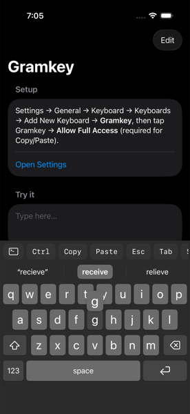
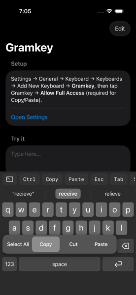
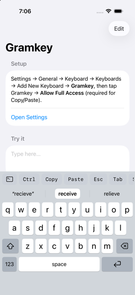

# Gramkey

**An iOS keyboard for people who live in terminals and text.** It looks and types like Apple's keyboard, and adds a shortcut bar you can customise (Esc, Tab, arrows, Ctrl+anything, your own snippets), a one-tap Terminal mode for SSH apps, Apple-style popout edit keys, and smart on-device autocorrect that learns your vocabulary. It doesn't use the network.

| Autocorrect + key callout | Hold space: edit tray | Light mode |
|:---:|:---:|:---:|
|  |  |  |

<sub>Simulator captures of the keyboard's SwiftUI view in the app's preview mode (`-previewKeyboard`). On a device it appears as your system keyboard.</sub>

### Features
- **Shortcut bar:** Copy, Paste, Esc, Tab, Shift+Tab, arrows, ⌫/Del, sticky **Ctrl**, Ctrl+C/D/Z/L/R/A/E/W/U, plus any text or escape sequence (`\e[A`, `^C`, `git status\n`). Tap **+** to add a chip without leaving the keyboard.
- **Terminal mode (`>_`):** Ctrl, Esc and arrows send raw control bytes and ANSI codes for SSH apps. In text mode they become editing commands: Ctrl+C/X/V copy, cut and paste; Ctrl+A selects all; Ctrl+W/U/K delete.
- **Hold space** for a popout tray: Select All · Copy · Cut · Paste. Slide to choose and release to run it.
- **Autocorrect on space**, ranked by keyboard-aware typo cost plus word frequency and your history. Backspace undoes a correction, iOS text replacements expand, and code-like text (`foo_bar`, `-flag`, `~/dir`) is left alone.
- **Predictions** from the word pairs you actually use, plus haptics and Apple-style key callouts.
- **Private by design:** no networking, no analytics, no keystroke logging. Learning is opt-out and can be cleared.

```
App/        container app: setup, Terminal mode, haptics/autocorrect/learning toggles, shortcut editor, AppIcon
Keyboard/   UIInputViewController + SwiftUI keyboard (keys, callouts, popout tray, shortcut and suggestion bars)
Shared/     shortcut model + escape decoding, cursor math, autocorrect engine, suggestions, App Group store
Icon/       app icon layer SVGs, generator, Icon Composer setup card
Tests/      unit tests for decoding, navigation, typo cost, autocorrect, learning, panel geometry
UITests/    screenshot and gesture tests
project.yml XcodeGen spec (the .xcodeproj is generated from it)
```

## Hold space: popout panel
Hold **space** (~0.5s) and a key tray pops up: **Select All · Copy · Cut · Paste**. Slide to highlight one (with a haptic tick), then release to run it. Releasing without sliding cancels. A tap still types a space; it fires on release. Select All arms the virtual select-all, and Copy/Cut/Paste then apply to the whole text. These items always edit text, even in Terminal mode.

## Typing feel
- **Key callouts:** letters pop out above your finger, like the system keyboard.
- **Haptics:** a light tap per key. Needs Full Access (an iOS rule for keyboards). It can be turned off in the app.
- **Autocorrect (on space and on . , ! ? ; :):** the strip shows `"typed"` · **correction** (highlighted: space applies it) · alternative. Backspace right after a correction restores what you typed and remembers it; tapping `"typed"` keeps it too. Text replacements from iOS Settings ("omw" → "On my way!") expand, and contact names are never changed. It won't touch fragments like `foo_bar`, `-flag`, `~/dir` or `@user`, or URL/email fields, and it's off in Terminal mode.
- **How it ranks (`Shared/Autocorrect.swift`):** score = −typo cost + word prior. The typo cost is a QWERTY-aware Damerau–Levenshtein: neighbouring keys, swapped letters, missing double letters and apostrophes are cheap. The prior combines word frequency (rank among UITextChecker's frequency-ordered completions), a common-words boost, how often you use the word, and the word you typed before it. It only corrects on a clear win, with a stricter bar for words of 3 letters or fewer.
- **Predictions:** after a space, the strip offers the words you usually type next (learned word pairs), falling back to common starters.
- **Learning (opt-out, clearable in the app):** stores only plain words of 2–24 letters and word pairs, on this device in the App Group. No digits or symbols, so tokens and keys aren't kept. Saving needs Full Access.

## Quick-add from the keyboard
Tap **+** at the end of the bar. Type a label, and optionally what it sends, then tap **Add** (or return). The keyboard keys type into the editor, not the app. If you leave *Sends* empty, `Ctrl+O` sends `^O`; any other label sends its own text. Saving needs Full Access; without it the chip lasts only until the keyboard reloads. Editing and deleting still happen in the app.

## Build & run

```bash
xcodegen generate
open Gramkey.xcodeproj
```

1. Set `DEVELOPMENT_TEAM` in `project.yml` (or in Xcode, Signing & Capabilities, for both targets). Then regenerate. The App Group `group.com.redveil.gramkey` must be registered to your team; change the ID in `project.yml` **and** `Shared/Shortcut.swift` if it is taken.
2. Run the **Gramkey** scheme on a device or simulator.
3. In Settings, go to General → Keyboard → Keyboards → Add New Keyboard → Gramkey, then turn on **Allow Full Access**.
4. Tests: `xcodebuild -scheme Gramkey -destination 'platform=iOS Simulator,name=iPhone 16' test`

## How keys reach the host app

The iOS keyboard API only offers `insertText`, `deleteBackward` and `adjustTextPosition`. There are no real key events.

Toggle with the **>_** chip at the start of the bar (or in the app).

| Key | Text mode | Terminal mode |
|---|---|---|
| ← → | move cursor | `ESC[D` / `ESC[C` |
| ↑ ↓ | move to the same column on the previous/next line (computed) | `ESC[A` / `ESC[B` |
| Del | forward delete | `ESC[3~` |
| Ctrl+C / X / V | copy / cut / paste | `0x03` / `0x18` / `0x16` |
| Ctrl+A | virtual select-all: the next Copy/Cut/Paste/Delete/typing applies to the whole text (the host shows no highlight; iOS can't select from a keyboard) | `0x01` |
| Ctrl+E, W / U / K | line end; delete word / to line start / to line end | raw control byte |
| Esc | hide keyboard | `0x1B` |
| Ctrl+Z, Ctrl+R, Shift+Tab… | toast: needs Terminal mode (no iOS API for undo) | raw bytes |
| Ctrl (sticky) | next letter typed becomes its control char | same |

SSH/terminal apps (Blink, Termius, a web terminal) forward these to the PTY. Ordinary text fields will show them as invisible characters. That is an iOS limitation, not a bug.

## Known limits
- No emoji key or dictation mic: iOS doesn't expose them to third-party keyboards. The system globe/mic row still appears on Face ID iPhones.
- iOS disables third-party keyboards in secure (password) fields and in some apps (phone pads).
- Copy only works when the host app exposes `selectedText`. Some apps don't.
- No autocorrect or predictions yet. There is no key-press popup callout yet.

## Security posture
Keyboards see every keystroke. This one has **no networking, no analytics, no logging**, and it persists only the shortcut config in the App Group. Full Access is requested only for `UIPasteboard`. Keep it that way: adding any network call to the extension changes the threat model.

## License
MIT, see [LICENSE](LICENSE).
